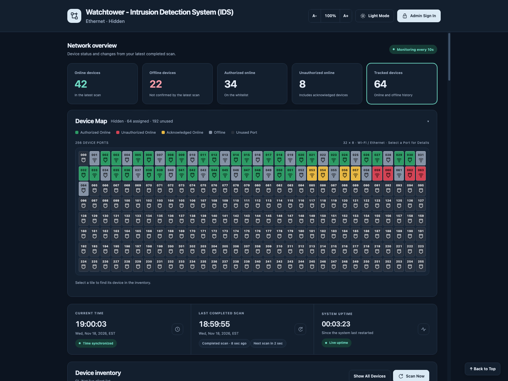
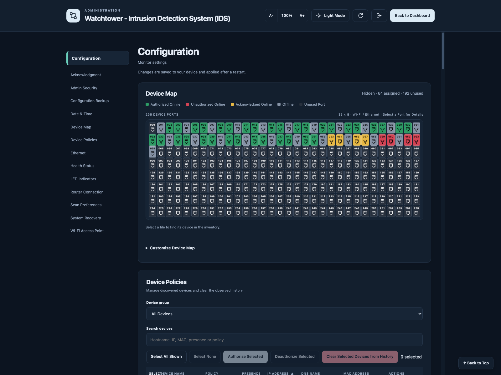
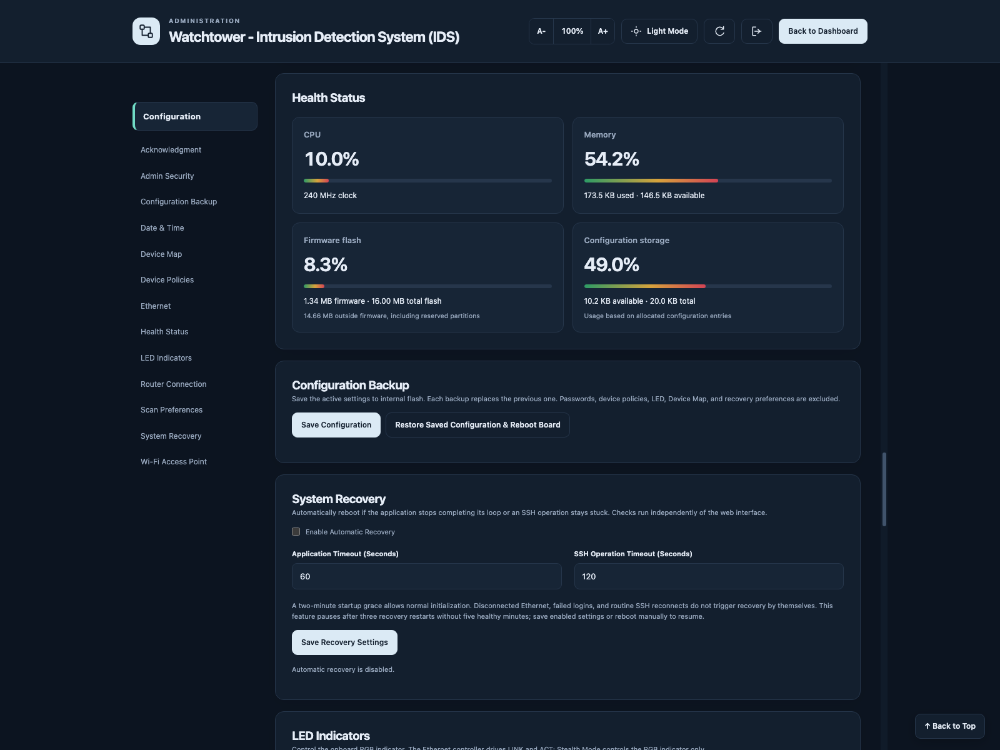

# Watchtower - Intrusion Detection System (IDS)

Watchtower monitors devices on a LAN using a **Waveshare ESP32-S3-ETH**. Its Ethernet connection supplies device discovery and router access. A password-protected Admin Console manages device policies and system settings. The interface builds on ESP32 Network Monitor.

## Interface preview

These screenshots use synthetic demo data. Network identifiers are hidden; no deployed device information, credentials, or private configuration is shown.

Admin Console: Device Map, health, and recovery controls

## Setup in Arduino IDE

1. Install **esp32 by Espressif Systems 3.3.12** and **LibSSH-ESP32 by Ewan Parker 5.10.0**. Open `IntrusionMonitor/IntrusionMonitor.ino` with its companion headers in the same folder.
2. Select the settings below and upload to the system's USB serial port. Leave **Erase All Flash Before Sketch Upload** disabled to retain saved settings.
3. Connect Ethernet to a LAN port that offers DHCP. Open Serial Monitor at **115200 baud** and send `?` to find the Ethernet address. The default hostname is `esp32ids`, so [esp32ids.local](http://esp32ids.local/) can also be used from a LAN client with mDNS support.
4. For direct wireless access, join **Watchtower** with **Password123** and open [Admin](http://192.168.4.1/admin). The default Admin username is **admin** and password is **Password123**. The AP starts by default. Its password and startup preference can be changed in Admin.

| Arduino setting | Value |
| --- | --- |
| Board | ESP32S3 Dev Module |
| Flash size | 16MB |
| PSRAM | OPI PSRAM |
| Partition scheme | Huge APP (3MB No OTA/1MB SPIFFS) |
| USB mode | Hardware CDC and JTAG |
| USB CDC On Boot | Enabled |

The firmware uses Waveshare's W5500 wiring. [Waveshare Arduino setup and pin assignments](https://docs.waveshare.com/ESP32-S3-ETH/Development-Environment-Setup-Arduino)

## Dashboard

The overview shows online, offline, authorized online, unauthorized online, and tracked-device totals from the latest completed scan. Unauthorized totals include acknowledged devices. The clock, last completed scan, next-scan countdown, and **System Uptime** show when the report was collected. The page refreshes every five seconds.

The **Device Map** on both pages is a **32-column × 8-row switch view with 256 logical ports numbered 000–255**. Port numbers follow the last IPv4 number: **010 represents 192.168.2.10** when viewing `192.168.2.x`. Different IP ranges have a selector so addresses on different ranges do not overlap. Devices without a usable IPv4 address remain in the inventory.

The grid scales to its frame without horizontal scrolling. On the Dashboard, select the **Device Map** heading to collapse or expand the box; the browser remembers your choice. Hover or focus an assigned port for device details; select it to find the device in the inventory. Scrolling stays inside the content frame, preserving the header. Wi-Fi, Ethernet, and unreported connection types have different icons. On compact screens the icons shrink and port labels are available through accessible names and device details. These are logical address slots, not physical switch-port assignments.

Under **Admin → Device Map → Customize Device Map**, choose a color, Blink switch, and **0.2–2.5 flashes/s speed slider** for every status, including Offline and Unused Port. Settings persist in internal storage and apply to both switch views. The current page updates after saving; other open pages refresh these settings within 30 seconds. Defaults are green steady authorized ports, red unauthorized ports blinking at 2 flashes/s, yellow acknowledged ports blinking at 0.4 flashes/s, gray offline ports, and dark-gray unused ports. Legends show status names only, with swatches that match the selected colors. **Randomize Online Device Blinking** gives online ports independent blink phases while keeping their selected speeds. Browser reduced-motion preferences keep animations steady.

The Dashboard’s **Show All Devices** button clears its search, presence, and policy-group filters immediately.

Both the Dashboard and Admin device tables support search, sortable data columns, and **Online**, **Offline**, and separate **Authorized**, **Unauthorized**, and **Acknowledged** groups for each presence state. These exact policy groups separate acknowledged devices from unauthorized devices, while the overview’s unauthorized total continues to include acknowledged devices. Admin keeps the Policy column near the left edge in every group; long names show their full values on hover, and narrow screens can scroll the table horizontally. **DNS name** comes from reverse DNS (PTR) queries to the Ethernet DNS server. **Device name** uses the router's alias or reported name when available. Successful DNS names are cached for five minutes, and failed lookups are retried after one minute. A cached name is reused while its device retains the same MAC and IP.

Dark and light themes, text sizing, themed scrollbars, fixed headers, and **Back to Top** controls are available on both pages.

## Discovery and coverage

Choose the source under **Admin → Scan Preferences**. The interval accepts **10–86,400 seconds**. A scan can take longer than the configured interval, so the next scan waits for the current work to finish. **Scan Now** requests an additional scan.

- **Local ARP / ping** discovers responsive IPv4 hosts on the reachable LAN. Automatic selection uses the Ethernet subnet, with a maximum of 254 addresses. CIDR or explicit ranges can also be configured. Sleeping and isolated devices may be missed. MAC-based policy controls require a known MAC address.
- **GL.iNet live client list** reads a compatible GL.iNet 4.x router's local inventory over SSH. Set the router's LAN IPv4 address, SSH port, username, and password under **Router Connection**. It uses the router's connection state and can include 5 GHz, MLO, and wired clients when those appear in the router's inventory.
- **OpenWrt HTTP (legacy)** retrieves records through authenticated HTTP/ubus on a compatible router.

GL.iNet scans reuse one authenticated SSH connection and open a fresh channel per scan. TCP keepalives help detect a lost connection. Watchtower reconnects on a later scan after a transport failure and checks the saved SSH host key again. If the identity changes, verify the router before using **Forget this identity** in Admin.

Up to **254 device rows** are stored, with the current report taking priority. Failed discovery retains the previous successful report and displays an error.

## Device policies

**Authorize** saves a MAC in the whitelist and marks the device authorized. **Deauthorize** returns it to Unauthorized. In Admin, check individual devices or use **Select All Shown** to select the current search results. Selection persists across searches and sorting. **Select None** clears the selection. Bulk controls authorize, deauthorize, or clear the selected devices from history.

**Acknowledge** suppresses an online unauthorized device's alert for the duration set under **Acknowledgment**. The default is **15 minutes**, with an allowed range of **1–10,080 minutes**. **Acknowledge All Online** applies that timer to every online unauthorized device. Acknowledgments expire when the timer ends and clear when the system restarts or the relevant history is cleared.

Saved whitelist entries survive restarts. **Clear All Device History** and **Clear Selected Devices from History** remove observed rows and their temporary state. Rediscovered devices can return on a later scan, with their saved policies applied again. A MAC allowlist controls labels and signaling in Watchtower. Router access permissions remain under the router's control. Rotating private MAC addresses can cause a device to appear as a new entry.

## LED indicators and buttons

Under **Admin → LED indicators**, choose colors and enable each state. Click **Apply LED Settings** to apply and save changes immediately. **Stealth Mode** toggles the system's saved RGB master switch and confirms the applied state. The button shows the next action (on or off), prevents repeated clicks while saving, and keeps the master checkbox in sync. Turning Stealth Mode off restores the configured status patterns. Stealth Mode controls the RGB indicator only. The W5500 directly drives the separate Ethernet LINK and ACT lights.

| State | Default color | Priority |
| --- | --- | --- |
| Unauthorized online | Red | Highest |
| Acknowledged online | Yellow | After Unauthorized |
| Scan activity | Blue, disabled by default | After acknowledged devices |
| Authorized / clear | Green | When no higher-priority condition applies |

The RGB indicator stays off while Ethernet is unavailable. Normal status signaling begins after a completed scan. Tap **BOOT** to acknowledge all online unauthorized devices. Hold **BOOT** for at least two seconds, then release it to restart. The hardware **RESET** button resets the chip directly. Admin also has a **Reboot System** button.

## Network, access point, and time settings

Under **Ethernet**, set **Hostname**, view the fixed Ethernet MAC, and choose DHCP or static IPv4. DHCP is the default. Static mode requires an address, subnet mask, gateway, and DNS server. The hostname is used for DHCP and the `hostname.local` dashboard address.

Under **Wi-Fi Access Point**, set the SSID, password, primary channel, and channel width. The ESP32-S3 supports 2.4 GHz. Channels **1–11** and **20 or 40 MHz** widths are available. **Save and restart AP** applies Wi-Fi changes without restarting the system. **Start AP** and **Stop AP** apply to the current session. **Enable AP persistently** and **Disable AP persistently** also control startup after reboot. Open Admin through Ethernet to stop or persistently disable the AP.

Under **Date & Time**, select a time zone, 12- or 24-hour format, and NTP server. The defaults are **America/New_York**, **24-hour**, and **time.nist.gov**. The browser formats synchronized UTC timestamps in the selected zone.

## Health Status

Admin displays CPU load and clock speed, memory usage and availability, firmware flash usage, and configuration-storage usage in responsive cards. CPU load is sampled from task runtime counters. Memory refers to the heap reported by the Arduino core. The Memory card also shows the lowest free heap since restart and the largest currently available block to help diagnose memory pressure. Serial Monitor’s `?` command reports the same counters. Firmware flash usage compares sketch size with physical flash capacity. The area outside the sketch includes reserved partitions.

Configuration storage uses NVS entry counts. Its percentage and estimated available capacity describe allocated entries within the NVS partition.

## Configuration backup and Admin security

**Save Configuration** stores the active network, AP, discovery, router connection, time, and acknowledgment settings in internal flash and replaces the previous backup. **Restore Saved Configuration & Reboot Board** validates and applies that backup, then restarts Watchtower. Save and restart first if you have pending edits in the main settings form.

Passwords, the whitelist, LED preferences, Device Map preferences, and recovery preferences are persisted separately from the backup. Restore retains their current values. Update the Admin password under **Admin Security** using **12–128 characters**. Blank password fields preserve their saved values.

Use the dashboard on a trusted LAN. The Admin Console uses password authentication over local HTTP. The public dashboard exposes the inventory to clients that can reach the system. Credentials and settings are stored in the ESP32's internal NVS storage.

## Development

Edit files in `web/`, then run `python3 tools/build_web_assets.py` before compiling. The generated header is committed with its source files. See the [development guide](docs/development.md) for the compile command, source layout, and release checks, and the [changelog](CHANGELOG.md) for changes.

See the [verification record](docs/verification.md) for completed checks and remaining hardware acceptance work.

## Admin navigation and session controls

Configuration items use matching title-case sidebar labels and section headings, with short hover descriptions. The Configuration label is boxed. Health usage bars use a green-to-amber-to-red gradient. The Admin header provides Reboot and Logout icons. Reboot asks for confirmation. A successful Admin page sign-in establishes an HttpOnly browser session. Background requests use that session and never issue a new browser login challenge. Sessions expire after eight hours without requests; up to eight browsers are retained. Logout ends only the current browser’s session and returns to the Dashboard. Other browsers remain signed in. If a session expires, Admin shows a Sign In link instead of repeatedly opening login dialogs. Restarting the system ends all sessions. Retained system settings are unchanged.

The scan timing bubbles are ordered **Completed scan**, then **Next scan**.

## System Recovery

Admin → System Recovery enables an independent health monitor, disabled by default. It reboots when the application loop stops completing (default 60 seconds) or one SSH operation remains stuck (default 120 seconds). Both timeouts are configurable and settings persist in internal storage; changes take effect immediately. A two-minute grace period follows startup or saving settings.

The monitor checks once per second and uses a separate 4 KB task stack. Ethernet outages, rejected logins, and ordinary SSH reconnects alone do not cause a reboot. Three recovery restarts without five healthy minutes pause automatic recovery to prevent a reboot loop. Saving enabled settings or manually restarting resumes monitoring. The status shows the last recovery cause. Recovery preferences are excluded from configuration backups.

This detects application and SSH stalls while the scheduler is running; it cannot determine remote browser reachability or recover a power failure. Existing hardware/SDK watchdog protections remain in place.
